# System Design: 16_weather_prediction

**Status:** Confirmed  
**Last updated:** 2026-10-22  
**Designed for champion:** lightgbm  
**Source:** written by ml-system-design from `ml_spec.yaml` (section `system`) and the answers in `answers/11_system.yaml`. Change the answers and rebuild; do not edit this file.

## Summary

The system is built on Hopsworks. It has 12 components. The design started from this evaluation decision: Go: promote lightgbm as the V1 champion and build the serving stack around it; it is never significantly worse than persistence in any city. It is a design only; each component is built later.

## Platform

The user chose Hopsworks for the deployed system, including the registry, the champion and the challenger; MLflow stays the record of local experiments.

## Why the System Is Built Now

The evaluation's go decision (beats persistence by 14.9% on test, meets the V1 bar on CV and test) matches the answer action to build the full serving stack.

## Diagram

Solid arrows carry data; dotted arrows control or trigger. Dashed boxes are not needed or not decided.

```mermaid
flowchart LR
    ingestion["Ingestion<br/>Hopsworks job (Python) writing to the feature group weather_daily"]
    data_validation["Validation<br/>Great Expectations suite attached to weather_daily (strict ingestion policy)"]
    features["Features<br/>Hopsworks feature group weather_features and a feature view (offline and online store)"]
    training["Training<br/>Hopsworks job creating training data from the feature view"]
    registry["Registry and gate<br/>Hopsworks model registry"]
    inference["Inference<br/>Hopsworks KServe predictor reading the online feature view"]
    serving["Serving<br/>Hopsworks model deployment (KServe) with a predictor script"]
    label_feedback["Label feedback<br/>Daily Hopsworks job joining actuals into the feature group scored_predictions"]
    monitoring["Monitoring<br/>Hopsworks feature monitoring plus Evidently, as a daily job after label feedback"]
    failure_handling["Fallback<br/>Fallback in the predictor script"]
    orchestration["Orchestration<br/>Hopsworks jobs with schedules"]
    testing["Tests<br/>pytest (tests/unit, tests/system) in GitHub Actions"]
    ingestion -->|raw data| data_validation
    data_validation -->|valid data| features
    features -->|training data| training
    training -->|candidate model| registry
    registry -->|champion| inference
    features -->|serving features| inference
    inference -->|predictions| serving
    inference -->|prediction log| label_feedback
    ingestion -->|actuals| label_feedback
    label_feedback -->|scored predictions| monitoring
    label_feedback -->|live scores for the gate| registry
    monitoring -.->|retrain trigger| training
    failure_handling -.->|fallback| serving
    orchestration -.->|schedules| ingestion
    orchestration -.-> training
    orchestration -.-> inference
```

## Settings

| Component | Needed | Tool | Settings |
|---|---|---|---|
| Data ingestion | Yes | Hopsworks job (Python) writing to the feature group weather_daily | frequency: hourly; source: Open-Meteo archive API, all 50 cities in one batched request per run; limits: Open-Meteo free tier (non commercial; per minute, hourly, and daily request caps), one request per run; fetch: the newest day only; feature group: weather_daily (primary key city, event time date) |
| Data validation | Yes | Great Expectations suite attached to weather_daily (strict ingestion policy) | checks: the 23 columns and their types, value ranges (temperatures -90 to 60 C; precipitation, snowfall, wind, radiation at least 0; wind direction 0 to 360; sunshine 0 to 86400 s; valid WMO weather_code), min <= mean <= max temperature, one row per city and date, only the 50 known cities; freshness: checked separately per city against its last complete local day; a late day triggers the fallback, not a rejection; on failure: reject the batch and alert |
| Feature pipeline and feature store (champion dependent) | Yes | Hopsworks feature group weather_features and a feature view (offline and online store) | served inputs: latitude, longitude, elevation, temp_max_change_1d, temp_max_vs_28d_mean, date_dayofyear, date_month, log_elevation, temperature_2m_max_lag_2d, temperature_2m_max_lag_3d, temperature_2m_max_lag_7d, temperature_2m_max_lag_364d, temperature_2m_min_lag_2d, temperature_2m_mean_lag_2d, apparent_temperature_max_lag_2d, apparent_temperature_min_lag_2d, precipitation_sum_lag_2d, snowfall_sum_lag_2d, wind_speed_10m_max_lag_2d, wind_gusts_10m_max_lag_2d, wind_direction_10m_dominant_lag_2d, shortwave_radiation_sum_lag_2d, sunshine_duration_lag_2d, weather_code_lag_2d, temperature_2m_max_roll_7d_mean_shift_2d, temperature_2m_max_roll_28d_mean_shift_2d, city; code: src/features.build_features, the same function used in training (features hash 32c8d1bec95ed0b7); rows: one per city and target date; the row for target date T uses data up to T minus 2 days; offline store: point in time training data from the feature view; online store: the latest row per city; every lag and rolling mean is precomputed, so a request only looks up the city; encoding: the ordinal encoding of city stays inside the model pipeline; backfill: run the feature pipeline once over 2024-01-01 to today, and again when a definition changes |
| Training pipeline | Yes | Hopsworks job creating training data from the feature view | trigger: on drift (from monitoring) or by hand; window: expanding, from 2024-01-01 to the last labelled day minus the 28 day holdout; refit: LightGBM with the champion's tuned settings, no retuning (retuning and new features stay in /ml-iterate); output: a candidate model in the Hopsworks registry; it becomes the challenger only if it passes the offline holdout test |
| Model registry and champion/challenger gate (champion dependent) | Yes | Hopsworks model registry | decides champion: Hopsworks registry decides the champion and challenger once deployed; MLflow keeps the local experiments, linked by the MLflow run id; gate: metric: MAE; test: name: diebold_mariano; alpha: 0.05; sided: one; window days: None; promotion: manual; entry: a candidate becomes the challenger when it beats the champion on the most recent 28 labelled days, after both models' training cutoffs, with the same one sided Diebold-Mariano test at alpha 0.05; live: the challenger predicts in shadow next to the champion; both are scored on the same city-days, and the owner promotes by hand once the test is significant; after promotion: the previous champion stays in shadow for 28 days, then is retired; lineage: model version, MLflow run id, feature view version, features hash, training dataset version |
| Inference | Yes | Hopsworks KServe predictor reading the online feature view | mode: online; schedule: on_request; steps: look up the city's latest feature row, check it is for tomorrow's target date (else the fallback), predict with the champion and every shadow model; logging: one row per model per request in the feature group predictions (request id and time, city, target date, model name and version, prediction, served or shadow, fallback used, feature row version, the persistence forecast); dedup: one prediction per city, target date, and model for the gate and monitoring, since repeat requests on a day use the same features |
| Serving and deployment | Yes | Hopsworks model deployment (KServe) with a predictor script | environments: prod; secrets: the owner's Hopsworks API key: the GitHub repository secret HOPSWORKS_API_KEY in CI, .env locally, the platform's own login inside jobs; never in code; contract: request {city}; response {city, target_date, forecast_max_c, model_version, fallback_used, inputs_as_of}; a city outside the 50 returns an error; rollback: switch the deployment to the previous model version, one step; code rollback: git revert on main, or the deploy workflow run by hand with an earlier commit; the model version is rolled back separately, by hand |
| Label feedback | Yes | Daily Hopsworks job joining actuals into the feature group scored_predictions | label arrives: the day after the target date (1 day label delay); join: city and target date; output: city, target date, model version, served or shadow, prediction, actual, absolute error |
| Monitoring (champion dependent) | Yes | Hopsworks feature monitoring plus Evidently, as a daily job after label feedback | data drift: PSI of each input against the same calendar month in training; alert above 0.25; prediction drift: PSI of the predictions against the same calendar month in training; alert above 0.25; performance: the served model's rolling 28 day live MAE against persistence on the same city-days; alert when the reverse one sided Diebold-Mariano test says the model is not better; shown next to the evaluation's monthly MAE (1.79 to 2.44 C); system health: failed jobs, predictor errors and latency, the daily share of requests served by the fallback (alert under 95% model served); alerts: email to the owner |
| Failure handling and fallbacks (champion dependent) | Yes | Fallback in the predictor script | fallback: persistence from the newest complete day when inputs are stale by up to 3 days or the model fails; the seasonal naive (the same date last year) when inputs are more than 3 days old; flags: fallback_used and inputs_as_of in every response; target: every request for one of the 50 cities gets a forecast; at least 95% of a day's requests are served by the model |
| Orchestration | Yes | Hopsworks jobs with schedules | order: hourly ingestion and validation, then the feature pipeline; daily label feedback, then monitoring; training on drift or by hand, then the offline holdout test; retries: two retries 10 minutes apart; a job that still fails alerts the owner, and the predictor keeps serving with the fallback; deployment: Hopsworks Git integration: the public GitHub repo is cloned to Resources/temperature-prediction-online-inference-system; a merge to main (protected: PR and passing checks) runs deploy.yml, which runs the checks, then deploy.apply (checks the clone out at the tested commit, installs the runtime dependency group from uv.lock into the environment weather, cloned from pandas-training-pipeline, when uv.lock changes, creates or updates the jobs in each pipeline's jobs/jobs.yaml, restarts the predictor, records Resources/deploy/state.json), then deploy.smoke; PRs get a dry run of the deploy; host: Hopsworks Serverless (eu-west), project weather_online_inference |
| Testing strategy | Yes | pytest (tests/unit, tests/system) in GitHub Actions | unit: build_features on a small fixed history (lags never shorter than 2 days, rolling means end on the last complete day), the fallback rules, src/compare.py's Diebold-Mariano and block bootstrap against known cases; the feature pipeline's rows match the training feature table on a committed fixture of three cities (training and serving skew); the deploy settings and the response contract; ci: pytest -m unit, ruff, and uv sync --locked on Python 3.11 (local) and 3.13 (the Hopsworks environment) on every PR and before every deploy; component: none: no Hopsworks test project; smoke: after every deploy: the hourly feature job runs, and one predictor response is checked against the contract; system: raw rows for one city through ingestion, features, the deployed predictor, and label feedback, ending in a scored prediction |

Parts marked champion dependent are redrafted when the champion changes; the rest is kept.

## Components

### Data ingestion

The draft fetched the last 7 days on each run to catch revisions. The user kept the newest day only, so the assumption that archive values never change stays untested; it is recorded as a risk.

### Data validation

A bad upstream day must never become features, while a late day is handled by the fallback.

### Feature pipeline and feature store

One build_features for training and serving means the features cannot drift apart, and precomputed rows keep request time work to a lookup.

### Training pipeline

The user chose refits on drift or by hand over a monthly schedule.

### Model registry and champion/challenger gate

The skill's rule asked for a margin of at least the champion's CV std (0.236 C). That spread mostly reflects how much harder some seasons are, which cancels out when both models are scored on the same days; paired gaps between models varied by only 0.03 to 0.05 C across 28 day windows. The user chose a paired one sided Diebold-Mariano test at alpha 0.05 instead, with manual promotion and no fixed window, and the skill was changed to allow a test in place of a margin. The frozen test set cannot serve as the entry check, because a refit trains on it and it has been opened 3 times, so a recent 28 day holdout is used.

### Inference

Only requested cities are scored, so the gate's live comparison depends on traffic; this is recorded as a risk.

### Serving and deployment

The user chose prod only; the draft had dev and prod. The user later chose to use their personal API key for CI.

### Label feedback

The gate's test and monitoring read only this table, so the join is done once.

### Monitoring

The user dropped the weekly archive revision check.

### Failure handling and fallbacks

The user changed the draft so the seasonal naive takes over after 3 days instead of an error after 7, so every request gets a forecast.

### Orchestration

The user chose Hopsworks Git integration over a versioned wheel, with merges to main deploying automatically. A spike showed jobs run in place on the /hopsfs mount, so job scripts import src from the clone by putting the repo root on sys.path. The Hopsworks environment runs Python 3.13, so CI tests 3.11 and 3.13. See docs/deployment.md.

### Testing strategy

The draft ran component tests against a separate Hopsworks test project. The user dropped component tests and the test project; the skew test moved to unit tests on a committed fixture, and a smoke check after each deploy catches what only real Hopsworks would show.

## Warnings Accepted

None.

## Risks

* Open-Meteo's archive serves recent days from one model and may replace them with ERA5 reanalysis about 5 days later; with the newest day fetched once and no revision check, a changed value would go unseen. Accepted by the user; if live MAE drifts from CV, re-fetch history and compare first.
* Only cities that are requested get predictions, so with light traffic the live Diebold-Mariano test may take months to reach significance. If the gate stalls, add a daily scheduled request for all 50 cities.
* Looking at the live test repeatedly with no fixed window and promoting at the first significant result raises the real false promotion rate above alpha. Accepted by the user, who promotes by hand and can wait for a longer window when the result is borderline.
* With prod only and unit tests only, new code first meets real Hopsworks in a deploy. Accepted by the user; the smoke check after each deploy and the predictor's fallback limit the damage, and a revert redeploys the previous commit.
* CI uses the owner's personal Hopsworks API key, which has every scope and is shared with local work. Accepted by the user; it is a GitHub secret, never printed, and docs/deployment.md says how to rotate it.
* Local development runs Python 3.11 and the Hopsworks environment runs 3.13. CI runs the unit tests on both.

## Open Questions

| ID | Question |
|---|---|
| Q5 | Which Hopsworks project and cluster will host the system, and which separate project runs the component tests? |

## Decisions

* Use Hopsworks for the deployed system, including the registry, champion, and challenger; MLflow keeps local experiments. The user chose it at the start of the design.
* The promotion gate is a paired one sided Diebold-Mariano test on daily MAE at alpha 0.05, with a recent 28 day holdout for the challenger entry, manual promotion, and the previous champion in shadow for 28 days. The user chose statistical significance over a fixed margin; the CV std margin reflected seasonal difficulty, not the noise of a paired comparison.
* When inputs are stale, serve persistence for up to 3 days, then the seasonal naive. The user's answer to Q1 (serve the baseline), refined so every request gets a forecast.
* Deploy with Hopsworks Git integration: every merge to main runs deploy.apply and deploy.smoke from GitHub Actions; jobs are set in each pipeline's jobs/jobs.yaml. The user chose it while planning the deployment; see docs/deployment.md.
* No component tests and no Hopsworks test project; the system runs on Hopsworks Serverless (eu-west) in the project weather_online_inference. The user's answer to Q5: CI runs unit tests only, including the skew test on a fixture.
