# System Design: 16_weather_prediction

**Status:** Confirmed  
**Last updated:** 2026-10-29  
**Designed for champion:** lightgbm  
**Source:** written by ml-system-design from `ml_spec.yaml` (section `system`) and the answers in `answers/11_system.yaml`. Change the answers and rebuild; do not edit this file.

## Summary

The system is built on Hopsworks. It has 12 components. The design started from this evaluation decision: Go: promote lightgbm as the V1 champion and build the serving stack around it; it is never significantly worse than persistence in any city. It is a design only; each component is built later.

## Platform

The user chose Hopsworks for the deployed system, including the registry, the champion and the challenger; MLflow stays the record of local experiments.

## Why the System Is Built Now

The evaluation's go decision (beats persistence by 14.9% on test, meets the V1 bar on CV and test) matches the answer action to build the full serving stack.

## Diagram

Solid arrows carry data; dotted arrows control or trigger. Dashed boxes are not needed or not decided.

```mermaid
flowchart LR
    ingestion["Ingestion<br/>Hopsworks job (Python) writing to the feature group weather_daily"]
    data_validation["Validation<br/>Great Expectations suite attached to weather_daily (strict ingestion policy)"]
    features["Features<br/>Hopsworks feature group weather_features and a feature view (offline and online store)"]
    training["Training<br/>Hopsworks job creating training data from the feature view"]
    registry["Registry and gate<br/>Hopsworks model registry"]
    inference["Inference<br/>Hopsworks KServe predictor reading the online feature view"]
    serving["Serving<br/>Hopsworks model deployment (KServe) with a predictor script"]
    label_feedback["Label feedback<br/>Daily Hopsworks job joining actuals into the feature group scored_predictions"]
    monitoring["Monitoring<br/>Own PSI (src.drift, the evaluation's formula) in one daily Hopsworks job, monitoring_pipeline_daily at 13:30 UTC, after label feedback and the live gate"]
    failure_handling["Fallback<br/>Fallback in the predictor script"]
    orchestration["Orchestration<br/>Hopsworks jobs with schedules"]
    testing["Tests<br/>pytest (tests/unit, tests/system) in GitHub Actions"]
    ingestion -->|raw data| data_validation
    data_validation -->|valid data| features
    features -->|training data| training
    training -->|candidate model| registry
    registry -->|champion| inference
    features -->|serving features| inference
    inference -->|predictions| serving
    inference -->|prediction log| label_feedback
    ingestion -->|actuals| label_feedback
    label_feedback -->|scored predictions| monitoring
    label_feedback -->|live scores for the gate| registry
    monitoring -.->|retrain trigger| training
    failure_handling -.->|fallback| serving
    orchestration -.->|schedules| ingestion
    orchestration -.-> training
    orchestration -.-> inference
```

## Settings

| Component | Needed | Tool | Settings |
|---|---|---|---|
| Data ingestion | Yes | Hopsworks job (Python) writing to the feature group weather_daily | frequency: daily; time: 12:15 UTC, when every city has passed local midnight (the job keeps the name feature_pipeline_hourly); source: Open-Meteo archive API, all 50 cities in one batched request per run; limits: Open-Meteo free tier (non commercial; per minute, hourly, and daily request caps), one request per run; fetch: the newest day only; feature group: weather_daily (primary key city, event time date) |
| Data validation | Yes | Great Expectations suite attached to weather_daily (strict ingestion policy) | checks: the 23 columns and their types, value ranges (temperatures -90 to 60 C; precipitation, snowfall, wind, radiation at least 0; wind direction 0 to 360; sunshine 0 to 86400 s; valid WMO weather_code), min <= mean <= max temperature, one row per city and date, only the 50 known cities; freshness: checked separately per city against its last complete local day; a late day triggers the fallback, not a rejection; on failure: reject the batch and alert |
| Feature pipeline and feature store (champion dependent) | Yes | Hopsworks feature group weather_features and a feature view (offline and online store) | served inputs: latitude, longitude, elevation, temp_max_change_1d, temp_max_vs_28d_mean, date_dayofyear, date_month, log_elevation, temperature_2m_max_lag_2d, temperature_2m_max_lag_3d, temperature_2m_max_lag_7d, temperature_2m_max_lag_364d, temperature_2m_min_lag_2d, temperature_2m_mean_lag_2d, apparent_temperature_max_lag_2d, apparent_temperature_min_lag_2d, precipitation_sum_lag_2d, snowfall_sum_lag_2d, wind_speed_10m_max_lag_2d, wind_gusts_10m_max_lag_2d, wind_direction_10m_dominant_lag_2d, shortwave_radiation_sum_lag_2d, sunshine_duration_lag_2d, weather_code_lag_2d, temperature_2m_max_roll_7d_mean_shift_2d, temperature_2m_max_roll_28d_mean_shift_2d, city; code: src/features.build_features, the same function used in training (features hash 32c8d1bec95ed0b7); rows: one per city and target date; the row for target date T uses data up to T minus 2 days; offline store: point in time training data from the feature view; online store: the latest row per city; every lag and rolling mean is precomputed, so a request only looks up the city; encoding: the ordinal encoding of city stays inside the model pipeline; backfill: run the feature pipeline once over 2024-01-01 to today, and again when a definition changes |
| Training pipeline | Yes | Hopsworks job creating training data from the feature view | trigger: by hand, after the owner reads the monitoring reports (drift alone may not need a refit); window: expanding, from 2024-01-01 to the last labelled day minus the 28 day holdout; refit: LightGBM with the champion's tuned settings, no retuning (retuning and new features stay in /ml-iterate); output: a candidate model in the Hopsworks registry; it becomes the challenger only if it passes the offline holdout test; reference: out-of-fold predictions for the last 364 training days, from a second fit on the days before them, saved with the model as reference.parquet for the prediction drift check |
| Model registry and champion/challenger gate (champion dependent) | Yes | Hopsworks model registry | decides champion: Hopsworks registry decides the champion and challenger once deployed; MLflow keeps the local experiments, linked by the MLflow run id; gate: metric: MAE; test: name: diebold_mariano; alpha: 0.05; sided: one; window days: None; promotion: manual; entry: a candidate becomes the challenger when it beats the champion on the most recent 28 labelled days, after both models' training cutoffs, with the same one sided Diebold-Mariano test at alpha 0.05; live: the challenger predicts in shadow next to the champion; both are scored on the same city-days, and the owner promotes by hand once the test is significant; rollout: challenger (shadow) -> canary -> ab -> champion, each step a tag edit and a restart by hand; the canary or ab tag holds traffic (the share of city-days), salt, since (the day the step began), and the challenger's window; canary serves the candidate on 10% then 25% of city-days, each step held until about 20 candidate city-days with no guardrail breach; ab serves it on 50% for a window fixed in advance, read with the ab- skills next to the paired live gate; the live gate decides the promotion; after promotion: the previous champion stays in shadow for 28 days, then is retired; lineage: model version, MLflow run id, feature view version, features hash, training dataset version |
| Inference | Yes | Hopsworks KServe predictor reading the online feature view | mode: online; schedule: on_request; steps: at startup, read the lifecycle_status tags: the champion serves, and the challengers plus models tagged retiring less than 28 days ago predict in shadow; per request, one batch lookup in the online feature view of the city's rows for tomorrow (its local date plus one), the three days before, and tomorrow minus 362 days (the seasonal row); a fresh row for tomorrow goes to the champion and every shadow, otherwise the fallback; with a candidate in canary or ab, a sha256 hash of salt, city, and target date assigns each city-day to the candidate or the champion (raising traffic only moves city-days to the candidate), the assigned model serves, and the other predicts in shadow; a failing assigned model serves persistence; logging: the KServe inference logger (mode ALL) writes every request and response to the deployment's Kafka topic; the job inference_pipeline_log reads it every 6 hours and writes one row per model per answered city to the offline feature group predictions (key request id and model version; request time, city, target date, served or shadow, prediction, fallback used and reason, inputs as of, feature row, the persistence forecast, the city-day's arm); dedup: label feedback keeps the first row per city, target date, and model, since repeat requests on a day use the same features |
| Serving and deployment | Yes | Hopsworks model deployment (KServe) with a predictor script | environments: prod; secrets: the owner's Hopsworks API key: the GitHub repository secret HOPSWORKS_API_KEY in CI, .env locally, the platform's own login inside jobs; never in code; contract: request {city}; response {city, target_date, forecast_max_c, model_version, fallback_used, fallback_reason, inputs_as_of, log}, where fallback_reason is model_error, stale, awaiting_today, seasonal, or no_champion, and log holds request_id, persistence_c, feature_row, and the shadow predictions for the inference logger; a city outside the 50, or one with no row to forecast from, gets {city, error} without failing the other cities in the request; rollback: retag by hand (the previous champion back to champion, the bad one to retiring or rejected), then restart the deployment; the deployment's model version only links it to the registry; code rollback: git revert on main, or the deploy workflow run by hand with an earlier commit; the model version is rolled back separately, by hand |
| Label feedback | Yes | Daily Hopsworks job joining actuals into the feature group scored_predictions | label arrives: the day after the target date (1 day label delay); join: city and target date; source: the actual maximum from weather_daily; output: city, target date, model version, served or shadow, prediction, actual, absolute error, persistence_c and its absolute error; model rows only (fallback rows stay in predictions); the first row per city, target date, and model; live gate: the candidate and every shadow model (challengers and retiring) against the champion on the city-days both scored, after both training cutoffs, one sided Diebold-Mariano from 14 shared days; written to the feature group gate_reports and copied to the model's tag as its live block |
| Monitoring (champion dependent) | Yes | Own PSI (src.drift, the evaluation's formula) in one daily Hopsworks job, monitoring_pipeline_daily at 13:30 UTC, after label feedback and the live gate | data drift: PSI of each input over the last 28 days, all 50 cities from weather_features, against the same calendar days in the champion's training data; flag above 0.25; prediction drift: PSI of the champion's live predictions over the last 28 days against its reference predictions on the same calendar days, for the cities seen live; flag above 0.25; performance: the served model's rolling 28 day live MAE against persistence on the same city-days; alert when the reverse one sided Diebold-Mariano test says the model is not better; shown next to the evaluation's monthly MAE (1.79 to 2.44 C); system health: the daily share of served answers from a model, not counting awaiting_today (flag under 95%), and failed jobs through the platform's job failure alerts; predictor errors and latency are not measured yet; canary guardrail: for a candidate in canary or ab, the city-days since its step began on which its forecast was more than 15 C from persistence, outside the contract range, or missing (None in shadow, or model_error on its own city-day); one row a day in the feature group canary_reports, flagged on any breach; alerts: none sent by the job; every check is a row in the feature group monitoring_reports with a flag, which the owner reads; the job fails when a step fails, so the platform's job failure email reaches the owner |
| Failure handling and fallbacks (champion dependent) | Yes | Fallback in the predictor script | fallback: persistence from the newest complete day when inputs are stale by up to 3 days, when the model fails, or when no model is tagged champion; the seasonal naive (the maximum 364 days before tomorrow) when inputs are more than 3 days old; from local midnight until the next daily feature run writes tomorrow's row (inputs one day old), persistence with the reason awaiting_today; two or three days old is stale; flags: fallback_used, fallback_reason, and inputs_as_of in every response; target: every request for one of the 50 cities gets a forecast; at least 95% of a day's requests are served by the model, not counting awaiting_today |
| Orchestration | Yes | Hopsworks jobs with schedules | order: daily ingestion and validation at 12:15 UTC, then the feature pipeline; daily label feedback, then monitoring (label feedback, live gate, checks in one daily job at 13:30 UTC); training by hand, then the offline holdout test; retries: two retries 10 minutes apart; a job that still fails alerts the owner, and the predictor keeps serving with the fallback; deployment: Hopsworks Git integration: the public GitHub repo is cloned to Resources/temperature-prediction-online-inference-system; after a merge to main (protected: PR and passing checks) the owner runs deploy.yml by hand from main; it runs the checks, then deploy.apply (checks the clone out at the tested commit, installs the runtime dependency group from uv.lock into the environments weather (jobs, cloned from pandas-training-pipeline) and weather-inference (the predictor, cloned from pandas-inference-pipeline, since deployments need an inference image) when uv.lock changes, uploads src/ as Resources/deploy/src.zip for the predictor, creates or updates the jobs in each pipeline's jobs/jobs.yaml, creates or updates the deployment temperatureforecast (inference logging on) and restarts it, records Resources/deploy/state.json), then deploy.smoke; PRs get a dry run of the deploy; tag changes (promotion, rollback, a new challenger) take effect when the deployment restarts, which the owner does by hand; host: Hopsworks Serverless (eu-west), project online_inference_v2 |
| Testing strategy | Yes | pytest (tests/unit, tests/system) in GitHub Actions | unit: build_features on a small fixed history (lags never shorter than 2 days, rolling means end on the last complete day), the fallback rules, src/compare.py's Diebold-Mariano and block bootstrap against known cases; the feature pipeline's rows match the training feature table on a committed fixture of three cities (training and serving skew); the deploy settings and the response contract; ci: pytest -m unit, ruff, and uv sync --locked on Python 3.11 (local) and 3.13 (the Hopsworks environment) on every PR and before every deploy; component: none: no Hopsworks test project; smoke: after every deploy: the hourly feature job runs, and one predictor response is checked against the contract; system: raw rows for one city through ingestion, features, the deployed predictor, and label feedback, ending in a scored prediction |

Parts marked champion dependent are redrafted when the champion changes; the rest is kept.

## Components

### Data ingestion

The draft fetched the last 7 days on each run to catch revisions. The user kept the newest day only, so the assumption that archive values never change stays untested; it is recorded as a risk. After the first deploy, the free tier ran out of compute and every hourly run failed from 2026-10-25, so the user moved ingestion to once a day. With one run a day, a feature row one day old is normal, so awaiting_today no longer depends on the local hour, and the cut-off hour that was an open question is gone.

### Data validation

A bad upstream day must never become features, while a late day is handled by the fallback.

### Feature pipeline and feature store

One build_features for training and serving means the features cannot drift apart, and precomputed rows keep request time work to a lookup.

### Training pipeline

The user chose refits by hand over a monthly schedule. While planning the monitoring pipeline, the user dropped the automatic trigger on drift, to understand an alert first (drift with good performance may not need a refit), and had training save out-of-fold reference predictions for the last year.

### Model registry and champion/challenger gate

The skill's rule asked for a margin of at least the champion's CV std (0.236 C). That spread mostly reflects how much harder some seasons are, which cancels out when both models are scored on the same days; paired gaps between models varied by only 0.03 to 0.05 C across 28 day windows. The user chose a paired one sided Diebold-Mariano test at alpha 0.05 instead, with manual promotion and no fixed window, and the skill was changed to allow a test in place of a margin. The frozen test set cannot serve as the entry check, because a refit trains on it and it has been opened 3 times, so a recent 28 day holdout is used. Later the user added a canary and A/B rollout after shadow, mainly to learn the pattern. Hopsworks deployments run one model version with no traffic split, so the split is inside the predictor, shaped like KServe's canary. The actual does not depend on which model served, so the paired live gate needs far fewer city-days than an unpaired A/B test and stays the decider; the A/B estimate is read against it. The 15 C guardrail comes from the test set, where the champion was never more than 12.1 C from persistence in 9,100 city-days.

### Inference

Only requested cities are scored, so the gate's live comparison depends on traffic; this is recorded as a risk. While planning the build, the user chose the registry tags over the deployment's model version to decide the champion, so the registry alone shows which model serves, and chose to read them only at startup and restart by hand. The user chose the KServe inference logger plus a 6 hourly job over writing the log from the predictor, for durability; a spike confirmed it works on Hopsworks Serverless.

### Serving and deployment

The user chose prod only; the draft had dev and prod. The user later chose to use their personal API key for CI. Rollback is now a tag change and a restart rather than a version switch, which follows from the tags deciding the champion. Errors are per city so one bad city does not fail a batch request.

### Label feedback

The gate's test and monitoring read only this table, so the join is done once.

### Monitoring

The user dropped the weekly archive revision check. While planning the monitoring pipeline, the user chose an own PSI function over Evidently and Hopsworks feature monitoring (cheaper on the free tier, testable, and the same formula as the evaluation), a rolling 28 day window, reports read by the owner instead of email, and one daily job.

### Failure handling and fallbacks

The user changed the draft so the seasonal naive takes over after 3 days instead of an error after 7, so every request gets a forecast. While planning the build, the user added persistence when no model is tagged champion, and the awaiting_today reason so the short gap after local midnight does not count against the 95% target.

### Orchestration

The user chose Hopsworks Git integration over a versioned wheel, with merges to main deploying automatically. A spike showed jobs run in place on the /hopsfs mount, so job scripts import src from the clone by putting the repo root on sys.path. The Hopsworks environment runs Python 3.13, so CI tests 3.11 and 3.13. See docs/deployment.md. A later spike showed predictor pods are different: the script is copied into the pod, HopsFS is not mounted, and the training environment is refused, so deploy ships src/ as a zip the predictor downloads at startup and keeps a second, inference environment with the same pins.

### Testing strategy

The draft ran component tests against a separate Hopsworks test project. The user dropped component tests and the test project; the skew test moved to unit tests on a committed fixture, and a smoke check after each deploy catches what only real Hopsworks would show.

## Warnings Accepted

None.

## Risks

* Open-Meteo's archive serves recent days from one model and may replace them with ERA5 reanalysis about 5 days later; with the newest day fetched once and no revision check, a changed value would go unseen. Accepted by the user; if live MAE drifts from CV, re-fetch history and compare first.
* Only cities that are requested get predictions, so with light traffic the live Diebold-Mariano test may take months to reach significance. A traffic simulator (src/inference_pipeline/jobs/simulate.py, run every hour by a launchd agent on the owner's laptop) sends 0 to 60 single-city requests in each hour for random cities at random times; about half reach the model and the rest fall in a city's awaiting_today gap. The user chose random traffic over full daily coverage to mimic real use while improvements are built and shadowed, and runs it locally rather than on GitHub Actions, so the gate gets data only while the laptop is on and online.
* Looking at the live test repeatedly with no fixed window and promoting at the first significant result raises the real false promotion rate above alpha. Accepted by the user, who promotes by hand and can wait for a longer window when the result is borderline.
* With prod only and unit tests only, new code first meets real Hopsworks in a deploy. Accepted by the user; the smoke check after each deploy and the predictor's fallback limit the damage, and a revert redeploys the previous commit.
* CI uses the owner's personal Hopsworks API key, which has every scope and is shared with local work. Accepted by the user; it is a GitHub secret, never printed, and docs/deployment.md says how to rotate it.
* Local development runs Python 3.11 and the Hopsworks environment runs 3.13. CI runs the unit tests on both.
* The predictor reads the registry tags only at startup, so a new challenger, a promotion, or a rollback has no effect until the deployment is restarted by hand. Accepted by the user; the gate job prints a reminder to restart when it makes a challenger, and docs/deployment.md lists the promotion and rollback steps.
* When the online feature store cannot be reached, the request fails with HTTP 500, since a KServe Python predictor cannot set its own status code. Accepted; monitoring counts predictor errors, and the city level errors cover every other failure.
* With one feature run a day, each city serves persistence from its local midnight until 12:15 UTC, about half of each day on average (about 1 hour in Auckland, 12 in London, 21 in Tokyo). Accepted by the user to save compute; the traffic simulator's random requests fall in this gap about half the time, like real traffic, and the 95% model-served target leaves awaiting_today out.
* An unpaired A/B test has little power here; at 50/50 with about 25 city-days per arm a day, a 0.066 C MAE gap (ridge against lightgbm on test) would take about a year and a half to detect. Accepted by the user; the A/B test runs for a window fixed in advance and is read against the paired live gate, which decides the promotion.
* The canary is stepped and rolled back by hand, so a candidate with breaches keeps serving its share until the owner reads canary_reports. Accepted by the user; a candidate that fails a prediction already falls back to persistence per request, and the guardrail catches plausible looking garbage within a day.

## Open Questions

| ID | Question |
|---|---|
| Q6 | How long after local midnight does the hourly feature job write each city's row for tomorrow? The predictor treats a missing row as awaiting_today until 03:00 local, a placeholder until this is measured. |

## Decisions

* Use Hopsworks for the deployed system, including the registry, champion, and challenger; MLflow keeps local experiments. The user chose it at the start of the design.
* The promotion gate is a paired one sided Diebold-Mariano test on daily MAE at alpha 0.05, with a recent 28 day holdout for the challenger entry, manual promotion, and the previous champion in shadow for 28 days. The user chose statistical significance over a fixed margin; the CV std margin reflected seasonal difficulty, not the noise of a paired comparison.
* When inputs are stale, serve persistence for up to 3 days, then the seasonal naive. The user's answer to Q1 (serve the baseline), refined so every request gets a forecast.
* Deploy with Hopsworks Git integration: every merge to main runs deploy.apply and deploy.smoke from GitHub Actions; jobs are set in each pipeline's jobs/jobs.yaml. The user chose it while planning the deployment; see docs/deployment.md.
* No component tests and no Hopsworks test project; the system runs on Hopsworks Serverless (eu-west) in the project weather_online_inference. The user's answer to Q5: CI runs unit tests only, including the skew test on a fixture.
* The lifecycle_status tags decide the champion and the shadows (challengers, and former champions tagged retiring for 28 days); the predictor reads them at startup, and the owner restarts it by hand. The user's choice while planning the inference pipeline: one place shows which model serves.
* Log predictions with the KServe inference logger and a 6 hourly job into the feature group predictions. The user chose durability and no logging code in the predictor; a spike confirmed it on Serverless.
* Run the feature pipeline once a day at 12:15 UTC; a feature row one day old serves persistence as awaiting_today at any hour. The free tier ran out of compute with hourly runs; the user chose once a day.
* No component tests and no Hopsworks test project; the system runs on Hopsworks Serverless (eu-west) in the project online_inference_v2. The user's answer to Q5: CI runs unit tests only, including the skew test on a fixture.
* Deploy with Hopsworks Git integration: the owner runs deploy.apply and deploy.smoke by hand from GitHub Actions; jobs are set in each pipeline's jobs/jobs.yaml. The user chose it while planning the deployment; see docs/deployment.md.
* Roll a challenger out as challenger (shadow), then canary at 10% and 25% of city-days, then a fixed 50/50 A/B test, then champion, split inside the predictor by a hash of salt, city, and target date, stepped and rolled back by hand, with an implausible value guardrail and the paired live gate as the decider. The user's choice, mainly to learn canary and A/B rollouts; Hopsworks has no traffic split, and the city-day keeps every request for a city on a day consistent and matches the scored unit.
